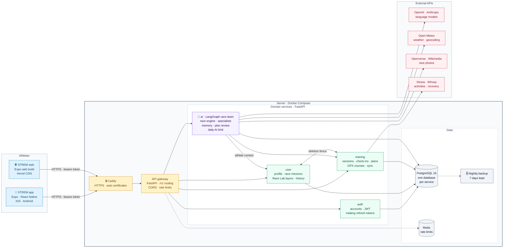
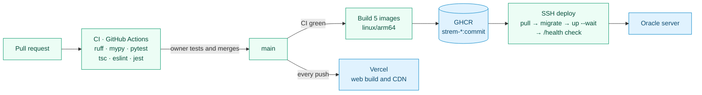

# STREM

**The AI race team for self-coached trail runners.** You commit to a race; STREM
turns your training data, your race and what you tell it into a week-by-week plan,
a race-day kit (fuel, gear, logistics, strategy) and a race team you can talk to.

The name comes from the Bulgarian *стремеж* — striving, upward movement.

## What it does

- **Race Mission** — pick a race (date, distance, climbing, checkpoints) and a goal.
- **Training plan** — built from your race and the training you already do, adapted
  when you miss sessions (every change waits for your review).
- **Race Lab** — course analysis from your GPX, plus fuel, gear, logistics and a
  checkpoint-by-checkpoint race strategy.
- **Race team** — specialists (coach, fuel, course, gear, logistics) that answer
  from your own data and remember what you tell them.
- **Race-day mode** — an offline race pack with live station cues; the finish feeds
  the debrief and your race history.
- **Your data** — export or delete everything, including your account.

## Architecture



**How a request flows.** The app sends every call to one public address. Caddy
terminates HTTPS and hands it to the gateway, which rate-limits per client and token
and forwards `/v1/<area>/…` to the service that owns that data. Services never read
each other's databases: the AI service reads the athlete's missions, plans and
check-ins through the other services' APIs, using the athlete's own token, so it can
only ever see what that athlete can see.

**How the race team thinks.** A deterministic race engine always builds the plan and
every Race Lab layer first. When an AI provider is available, a LangGraph graph routes
the question to specialists (coach, fuel, course, gear, logistics) that answer from the
athlete's data and long-term memory, and a review graph pauses every plan change until
the athlete approves it. Every output carries its origin (engine, AI or athlete), and
without an API key, credit or daily allowance the engine carries on and the app says so.

### Delivery



### Code layout

| Path | What it is | Database |
|---|---|---|
| `apps/mobile` | Expo / React Native app for iOS, Android and web | — |
| `services/gateway` | The single public API: routes `/v1/*`, CORS, rate limits | Redis |
| `services/auth` | Accounts, JWT access tokens, rotating refresh tokens | `strem_auth` |
| `services/user` | Profile, race missions, Race Lab layers, race history, legal acceptance | `strem_user` |
| `services/training` | Sessions, check-ins, plans, GPX courses, Strava and Whoop | `strem_training` |
| `services/ai` | LangGraph race team, race engine, memory, daily AI limit (OpenAI or Anthropic) | `strem_ai` |
| `deploy/` | Docker Compose (local and production), Caddy, scripts (migrate, seed, backup) | — |
| `docs/` | Product description and legal texts | — |

Each service owns its database and its schema migrations (Alembic, one initial
revision plus whatever comes after it).

## Run it locally

Needs Docker and Node 20.

```bash
cp deploy/.env.example deploy/.env        # add OPENAI_API_KEY for the AI race team
docker compose --env-file deploy/.env -f deploy/docker/docker-compose.yml up -d --build
python deploy/scripts/migrate-stack.py    # database migrations
python deploy/scripts/seed-demo.py        # demo athlete: race-demo@strem.app / NeverSettle123!

cd apps/mobile && npm ci
EXPO_PUBLIC_API_URL=http://localhost:8000/v1 npx expo start --web
```

Without an AI key everything still works: the rule-based engine builds plans and
Race Lab, and the app says when the AI was not used.

## Tests

- Services: `cd services/<name> && pip install -r requirements.txt -r requirements-dev.txt && ruff check . && mypy . && pytest`
- App: `cd apps/mobile && npm ci && npx tsc --noEmit && npm run lint && npm test`
- End to end (starts every service on SQLite): `cd apps/mobile && npx playwright test`

CI runs all of this on every pull request.

## License

[MIT](LICENSE)
