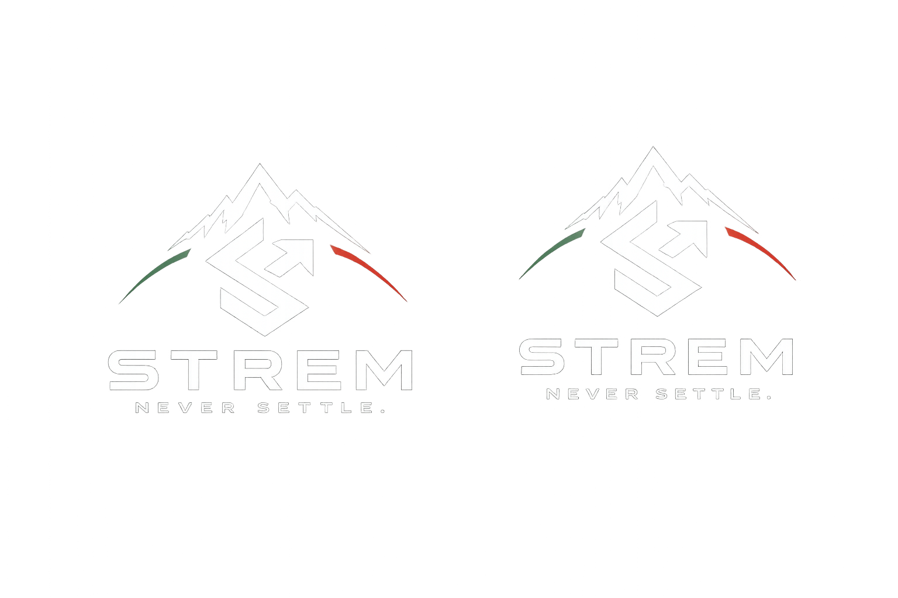
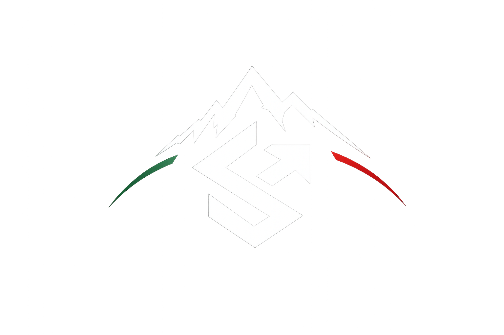

# STREM Brand Identity

STREM is a premium performance brand built around disciplined growth. It should feel strong, minimal, resilient, and exact. The brand is not about casual wellness or quick motivation. It is about identity, effort, consistency, and upward movement.

## Core Meaning

The name is inspired by the Bulgarian word `stremezh`, meaning striving, ambition, discipline, constant growth, and the drive to become stronger every day.

STREM should communicate:

- ambition without arrogance
- discipline without punishment
- community without noise
- AI without coldness
- premium design without vanity
- transformation without false promises

## Visual Direction

The supplied logo establishes the brand system:

- black and white premium base
- green, white, and red accents inspired by the Bulgarian flag
- mountain as resilience, ascent, and Bulgarian heritage
- arrow as upward movement and ambition
- stylized `S` as strength, simplicity, and identity
- north star as purpose, standards, and direction

The product should visually feel like a serious training command center, not a social media clone.

## Approved Logo Variations

The current approved logo variation references live in `assets/brand/`:

Use these as brand references for mood, contrast, mountain/symbol relationship, Bulgarian accent color placement, and premium dark presentation. Do not treat the glow-heavy treatment as a default UI style; it is a presentation and launch-asset direction. Product UI should remain clean, legible, and restrained.

Approved usage:

- investor or founder materials
- brand exploration
- launch visuals
- social previews
- app-store style presentation references
- future design-system inspiration

Avoid:

- placing heavy glow effects inside everyday product screens
- using low-contrast white-on-glow text for functional UI
- stretching, recoloring, or cropping the mark in ways that weaken the mountain, arrow, or `S`
- introducing additional accent colors beyond the premium monochrome base and Bulgarian green/red accents

## Tone

STREM speaks with controlled confidence:

- direct
- calm
- precise
- encouraging
- evidence-aware
- never preachy
- never gimmicky

Preferred phrases:

- `Never Settle.`
- `Build the identity first.`
- `Train the system, not the mood.`
- `Small wins. Relentless direction.`
- `Discipline becomes freedom.`

Avoid:

- toxic positivity
- extreme body-transformation promises
- childish gamification language
- vague hustle culture
- medical claims without evidence

## Product Feel

STREM should eventually combine the best operating principles of Strava, MyFitnessPal, WHOOP, Oura, Freeletics, Discord communities, Duolingo progression systems, Notion organization, and Apple ecosystem thinking.

That does not mean cloning their interfaces. It means combining:

- accurate logs
- structured guidance
- community accountability
- progression loops
- premium clarity
- AI personalization
- privacy-conscious data systems

## Brand Standard

Every product, engineering, and AI-agent decision should answer:

Does this make STREM more disciplined, trustworthy, useful, and identity-forming?
